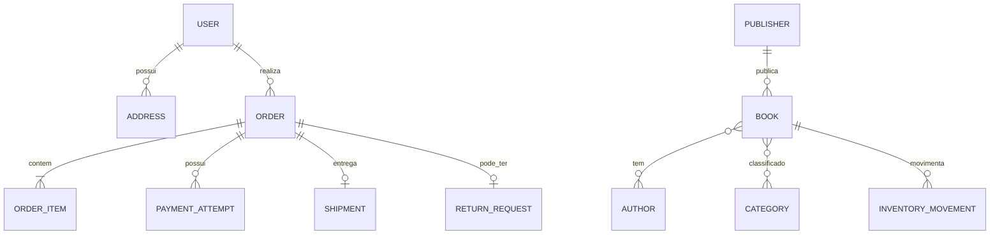
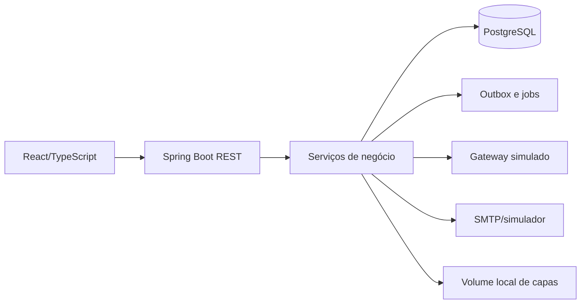

# Livraria Online

**Versão:** 1.0  
**Status:** PLANEJAMENTO APROVADO

## 1. Visão do projeto

Uma loja online responsiva para uma única livraria brasileira vender livros físicos novos. O sistema reduz divergências entre catálogo e estoque, oferece ao cliente um ciclo confiável de compra e entrega, e centraliza a operação administrativa com rastreabilidade.

O MVP cobre o ciclo completo desde o cadastro até a entrega, cancelamento ou devolução. A aplicação será um monorepo com API REST em Java/Spring Boot e frontend React/TypeScript, executável localmente por Docker Compose.

## 2. Escopo do MVP

- Cadastro, login, logout, recuperação de senha, perfil e endereços de clientes.
- Catálogo pesquisável por título, autor, ISBN-13 e editora; filtros por categoria, preço, autor e disponibilidade; paginação.
- Detalhe de livro, carrinho, checkout, frete simulado por CEP, PIX e cartão simulados, pedidos e rastreio simulado.
- Reserva transacional de estoque na criação do pedido, expiração e devolução de reserva.
- Devolução integral do pedido, cancelamento, reembolso e histórico de status.
- Administração de catálogo, estoque, preços, pedidos, pagamentos, configurações, relatórios básicos, usuários e permissões.
- LGPD básica: aceite versionado, consentimento separado, exportação, solicitação de anonimização e minimização de dados.
- Logs, auditoria, backup/recuperação, notificações de teste, jobs persistentes e CI.

## 3. Fora de escopo

- Apps Android/iOS, PWA, multiloja, multimoeda, idiomas adicionais e vendas internacionais.
- E-books, usados, kits, pré-venda, boleto, avaliação, lista de desejos, cupons, promoções e campanhas de marketing.
- Nota fiscal, transportadora/gateway/e-mail reais, armazenamento externo de objetos, entrega contínua e monitoramento avançado.
- Devolução parcial por item e MFA (evolução prioritária).

## 4. Stakeholders e atores

| Ator | Objetivo e permissões principais |
|---|---|
| Cliente | Gerir a própria conta, buscar livros, comprar, acompanhar, cancelar nos limites e solicitar devolução. |
| Administrador geral | Acesso total; gerencia perfis administrativos, configurações e logs. |
| Gerente de catálogo e estoque | Mantém livros, autores, editoras, categorias, preços e movimentações de estoque. |
| Financeiro | Consulta pagamentos, trata pendências de estorno e consulta vendas/faturamento. |
| Atendimento | Consulta clientes/pedidos, altera etapas logísticas, trata cancelamentos/devoluções. |
| Sistema/gateway simulado | Notifica pagamentos/estornos e executa expirações e novas tentativas. |

## 5. Requisitos funcionais

| ID | Requisito | Critério de aceitação resumido |
|---|---|---|
| RF-001 | Cadastro e autenticação | Cliente cadastra nome, e-mail, senha e aceite; login, logout e bloqueio após 5 erros funcionam. |
| RF-002 | Recuperação e segurança da conta | Link de uso único expira em 30 min e encerra sessões ao redefinir senha. |
| RF-003 | Perfil, endereço e LGPD | Cliente corrige dados, exporta dados e solicita anonimização quando não há pedido em andamento. |
| RF-004 | Catálogo e busca | Busca título/autor/ISBN/editora, filtros permitidos e paginação de 20 itens. |
| RF-005 | Detalhe e mídia de livro | Exibe dados e capa; upload aceita JPG/PNG/WebP até 2 MB. |
| RF-006 | Carrinho | Adiciona, remove e altera quantidade sem reservar estoque; alerta indisponibilidade posterior. |
| RF-007 | Checkout e frete | Revalida estoque, congela dados do pedido e calcula zona de CEP configurável. |
| RF-008 | Pagamento simulado | PIX/cartão permitem comportamento controlado; webhook assinado e idempotente atualiza tentativa. |
| RF-009 | Reserva e concorrência | Criação do pedido reserva em transação; duas compras da última unidade resultam em um único sucesso. |
| RF-010 | Pedido, rastreio e cancelamento | Cliente acompanha histórico e cancela antes do envio conforme transições válidas. |
| RF-011 | Devolução e reembolso | Devolução integral segue prazos, gera retorno simulado e dispara estorno após conferência. |
| RF-012 | Notificações | Eventos definidos geram e-mails assíncronos de teste, com novas tentativas sem desfazer pedidos. |
| RF-013 | Administração e RBAC | Cada perfil acessa apenas as ações autorizadas; ações sensíveis são auditadas. |
| RF-014 | Catálogo e estoque administrativos | Mantém entidades, desativa registros vinculados e registra cada movimento de estoque. |
| RF-015 | Operação administrativa | Atendimento opera logística/devolução; financeiro consulta e resolve pendências de estorno. |
| RF-016 | Relatórios básicos | Exibe vendas, mais vendidos e estoque baixo com filtros de período aplicáveis. |
| RF-017 | Configurações da loja | Administrador mantém dados institucionais e faixas de frete. |
| RF-018 | Operação assíncrona | Outbox persistente processa expiração, e-mail, estorno e prazo de devolução após reinício. |

## 6. Regras de negócio

| ID | Regra |
|---|---|
| RN-001 | Somente livros físicos novos, ativos, com preço > 0, ISBN-13 único e estoque disponível podem ser comprados. |
| RN-002 | Livro pode ter autores/categorias múltiplos e uma editora; autor tem ordem de exibição. |
| RN-003 | Carrinho não reserva estoque. Pedido reserva na criação, dentro de transação. |
| RN-004 | Reserva PIX dura 30 min; cartão dura 15 min, no máximo 3 tentativas e apenas uma em processamento. Prazos são configuráveis. |
| RN-005 | Pedido tem status próprio: aguardando pagamento, pagamento confirmado, em separação, enviado, entregue, cancelado, devolução solicitada, devolvido. |
| RN-006 | Tentativa de pagamento: pendente, processando, aprovada, recusada, expirada, cancelada, estorno pendente, estornada ou estorno com falha. |
| RN-007 | Pedido cancelado devolve estoque imediatamente. Pagamento tardio não reativa pedido: abre estorno e gera alerta ao financeiro. |
| RN-008 | Dados de cliente, endereço, itens, preço, frete, total e meio de pagamento são cópias imutáveis no pedido. |
| RN-009 | Envio exige rastreio simulado; somente atendimento/administrador atualiza etapas logísticas. Cada transição é auditada. |
| RN-010 | Cliente cancela até pagamento confirmado; atendimento/admin pode cancelar antes do envio. Correção de endereço só por atendimento, antes do envio e na mesma zona de frete. |
| RN-011 | Devolução é integral: arrependimento até 7 dias; defeito ou item divergente até 30 dias. Atendimento analisa em 2 dias úteis e cliente posta em 7 dias. |
| RN-012 | Após item recebido e conferido, estorno integral é solicitado; item só retorna ao estoque se revendável. |
| RN-013 | Registros vinculados são desativados, não excluídos; exclusão física só é permitida sem vínculos. |
| RN-014 | Dados de cartão não são armazenados; apenas identificador da transação retornado pelo gateway. |
| RN-015 | Usuários administrativos são criados exclusivamente pelo administrador geral e são desativados, nunca apagados. |
| RN-016 | Anonimização bloqueia enquanto houver pedido em andamento e preserva valores/histórico sem identificadores diretos. |

## 7. Requisitos não funcionais

| ID | Requisito verificável |
|---|---|
| RNF-001 | Layout responsivo a partir de 360 px nas duas últimas versões de Chrome, Edge, Firefox e Safari; Chrome Android e Safari iOS. |
| RNF-002 | Meta WCAG 2.1 AA: teclado, foco visível, contraste, textos alternativos e rótulos; validação Lighthouse e manual. |
| RNF-003 | Catálogo/busca em até 2 s no p95, página até 3 s e criação de pedido até 3 s, sem tempo do gateway. |
| RNF-004 | Suportar 5.000 títulos, 10.000 clientes, 300 pedidos/dia, 50 navegadores e 10 checkouts concorrentes. |
| RNF-005 | Disponibilidade alvo de 99% mensal; backup diário por 7 dias, RPO 24 h, RTO 4 h e teste de restauração. |
| RNF-006 | Senhas usam bcrypt ou Argon2; HTTPS em produção; sessão HttpOnly/Secure/SameSite; entradas validadas. |
| RNF-007 | Logs não contêm senha, cartão ou dados sensíveis desnecessários; auditoria preserva ator, data e motivo. |
| RNF-008 | API possui OpenAPI; build, testes e verificações automatizadas rodam localmente e no CI. |

## 8. Casos de uso

| UC | Atores | Resultado |
|---|---|---|
| UC-001 | Cliente | Cria/recupera acesso e mantém conta. |
| UC-002 | Cliente | Pesquisa e consulta livro. |
| UC-003 | Cliente/Sistema | Fecha pedido, reserva estoque e inicia pagamento. |
| UC-004 | Gateway/Sistema | Confirma/recusa/expira tentativa idempotentemente. |
| UC-005 | Cliente/Atendimento | Consulta, cancela e acompanha pedido. |
| UC-006 | Cliente/Atendimento/Financeiro | Solicita, trata devolução e estorna pagamento. |
| UC-007 | Catálogo/Administrador | Mantém catálogo, preço, mídia e estoque. |
| UC-008 | Atendimento/Financeiro/Admin | Opera pedidos, pendências, relatórios e permissões. |

## 9. Modelo de domínio

Entidades principais: `User`, `Role`, `Address`, `Consent`, `Book`, `Author`, `Publisher`, `Category`, `BookImage`, `InventoryMovement`, `Cart`, `CartItem`, `Order`, `OrderItem`, `PaymentAttempt`, `Shipment`, `ReturnRequest`, `OutboxMessage`, `AuditLog`, `StoreSettings` e `ShippingZone`.

## 10. Arquitetura e tecnologia

Monólito modular em camadas: apresentação (React e controladores REST), negócio (serviços, regras, interfaces/ports) e acesso a dados (JPA/repositórios e adaptadores). O backend usa Java 21, Spring Boot, Maven, Flyway e PostgreSQL; frontend usa React e TypeScript. Docker Compose sobe frontend, backend, PostgreSQL e serviço de e-mail de teste.

Detalhes: [arquitetura](docs/architecture/architecture.md), [modelo de dados](docs/architecture/data-model.md) e [diagramas](docs/diagrams/).

## 11. API prevista

Prefixo `/api/v1`; contrato OpenAPI publicado pela aplicação. A API usa DTOs, paginação e autorização server-side. Erros usam envelope consistente com código, mensagem segura, detalhes de campo e `correlationId`.

| Recurso | Operações previstas | Autorização |
|---|---|---|
| `/auth` | cadastro, login, logout, recuperação, redefinição e convite | pública, exceto convite administrativo |
| `/me`, `/addresses`, `/privacy` | perfil, endereços, consentimentos, exportação e anonimização | titular autenticado |
| `/books`, `/authors`, `/publishers`, `/categories` | consulta pública; manutenção e desativação | público para leitura; catálogo/admin para escrita |
| `/cart` | consultar e alterar itens | cliente autenticado |
| `/checkout`, `/orders` | cotar frete, criar pedido, consultar histórico, cancelar e solicitar devolução | cliente titular |
| `/payments`, `/webhooks/payments` | iniciar tentativa, consultar estado e receber webhook idempotente | cliente para consulta; assinatura para webhook |
| `/admin/orders`, `/admin/returns`, `/admin/inventory` | logística, devolução, estoque e intervenções justificadas | papel administrativo específico |
| `/admin/users`, `/admin/settings`, `/admin/reports`, `/admin/audit` | usuários, loja/frete, relatórios e auditoria | administrador geral ou papel explicitamente autorizado |

Contratos críticos: o checkout recebe somente referência do endereço/meio de pagamento e retorna identificador do pedido/tentativa; os valores retornados são snapshots. O webhook recebe identificador de evento, identificador de tentativa, resultado e assinatura; eventos repetidos respondem com sucesso sem repetir efeitos. A OpenAPI detalhará esquemas, códigos HTTP, paginação e matrizes de erro durante as TASKs correspondentes.

## 12. Segurança e privacidade

RBAC por perfil, sessão no servidor via cookie, proteção CSRF compatível com SPA, rate limit/bloqueio de login, validação server-side, autorização por recurso e logs de auditoria. Termos e política são aceitos com versão/data; marketing é opcional e revogável. Retenções propostas: acesso 6 meses, auditoria 12 meses, erro 90 dias, e-mail completo 30 dias, pedidos/devoluções/estoque 5 anos. Estes prazos são proposta acadêmica e exigem validação jurídica para produção.

## 13. Estratégia de testes

Testes unitários para estoque, status, pagamento e estorno; integração para API e PostgreSQL; E2E para cadastro, compra, cancelamento, devolução e administração; e teste dedicado de concorrência da última unidade. Quality gates: build, lint, testes aplicáveis, segurança, acessibilidade, critérios de aceitação e regressão.

## 14. Roadmap, riscos e rastreabilidade

O plano é dividido em fundação, identidade/catálogo, compra, operação e qualidade, com checkpoints ao final de cada fase em [TASKS.md](TASKS.md). Riscos principais: inconsistência entre pagamentos e estoque, dados pessoais em logs, simulações divergirem de integrações reais e regras legais de devolução/retenção. Mitigações: transações, idempotência, outbox, testes de concorrência, interfaces substituíveis e ADRs.

| Requisitos | Casos de uso | Módulos/API | Tarefas principais |
|---|---|---|---|
| RF-001..003, RN-014..016 | UC-001 | auth, customers | TASK-004..007 |
| RF-004..006, RN-001..002 | UC-002 | catalog, cart | TASK-008..012 |
| RF-007..010, RN-003..010 | UC-003..005 | checkout, orders, payments, shipping | TASK-013..020 |
| RF-011..012, RN-011..012 | UC-006 | returns, notifications | TASK-021..023 |
| RF-013..018, RN-013..015 | UC-007..008 | admin, reports, outbox | TASK-024..029 |
| RNF-001..008 | Todos | cross-cutting | TASK-003, 030..033 |
"# PM_Loja_Online_Livros" 
